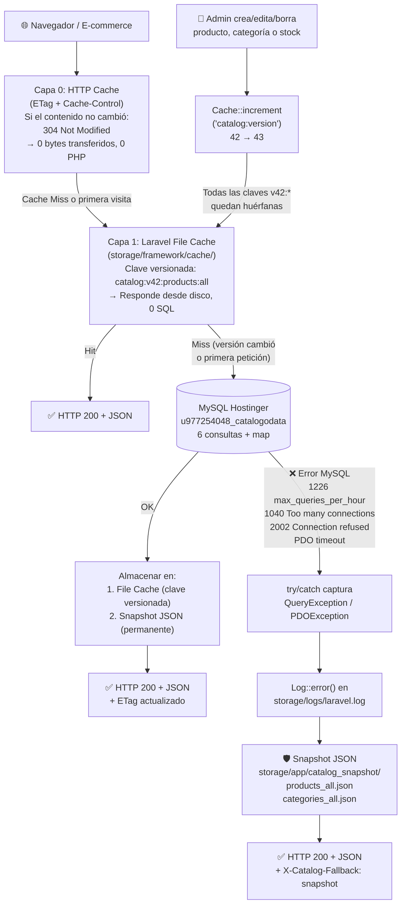

# ⚡ Plan de Caché — Catálogo Plaxtilineas (`backend-laravel`)

> **Objetivo:** Eliminar consultas SQL redundantes a MySQL en Hostinger para evitar alcanzar los límites de `max_queries_per_hour` y `max_user_connections`, manteniendo los datos siempre frescos al instante y el catálogo funcionando incluso si MySQL cae.

---

## 1. Diagnóstico — Estado Actual (sin caché)

### 1.1 Consultas SQL por endpoint

Cada petición pública al catálogo ejecuta eager loading con 5 relaciones:

```php
Product::with(['categoryRelation', 'subcategory', 'images', 'colors', 'variants'])
```

Esto genera **6 consultas SQL por petición** (1 tabla principal + 5 relaciones). Mapa completo:

| Endpoint | Verbo | Consultas SQL | Frecuencia de uso |
|---|:---:|:---:|---|
| `/api/productos` (lista completa) | GET | 6 | 🔴 Crítica — cada carga del catálogo (65+ productos × 5 relaciones) |
| `/api/productos?brand=X` | GET | 6 | 🔴 Crítica — filtro por marca (Plaxtilineas, Districol, etc.) |
| `/api/productos?categoria=X` | GET | 6 | 🟡 Alta — filtro por categoría |
| `/api/productos/categoria/{cat}` | GET | 6 | 🟡 Alta — secciones del catálogo |
| `/api/productos/{id}` | GET | 6 | 🟢 Media — detalle de producto |
| `/api/productos/slug/{slug}` | GET | 6 | 🟢 Media — detalle por slug (SEO) |
| `/api/categorias` | GET | 2 | 🔴 Crítica — menú de navegación, se llama en CADA carga |
| `/api/categorias?brand=X` | GET | 2 | 🟡 Alta — menú filtrado por línea |
| `/api/categorias/{id}/subcategorias` | GET | 1 | 🟢 Media — selector de subcategorías |
| `/api/inventario/cambios` (polling) | GET | 1 (`MAX(id)`) | 🔴 Crítica — cada 5 s por cada cliente conectado |
| `/api/inventario/stream` (SSE) | GET | 1 (`WHERE id > X` cada 2 s) | 🔴 Crítica — polling interno en loop de 20 s |

### 1.2 Cálculo de impacto con tráfico real

**Escenario conservador:** 300 usuarios simultáneos navegando el catálogo y el e-commerce.

```
Carga inicial de cada usuario:
  GET /api/categorias           →   2 consultas
  GET /api/productos?brand=X    →   6 consultas
  Total por usuario             =   8 consultas

Navegación (promedio 5 páginas/min):
  5 × 6 consultas               =  30 consultas/min/usuario

Polling de inventario (cada 5 s):
  12 × 1 consulta               =  12 consultas/min/usuario
```

| Concepto | Consultas/min | Consultas/hora |
|---|---:|---:|
| 300 usuarios × 30 consultas de navegación | 9.000 | 540.000 |
| 300 usuarios × 12 consultas de polling | 3.600 | 216.000 |
| **Total estimado** | **12.600** | **756.000** |

> Los planes de Hostinger Business limitan a **~250.000–500.000 consultas/hora**. Con 300 usuarios el sistema superaría el límite incluso sin picos.

### 1.3 Puntos de escritura que deben invalidar la caché

Tras analizar **todos los métodos de escritura** en los controladores:

| Controller | Método | Acción que modifica datos |
|---|---|---|
| `ProductController` | `store()` | Crea producto + imágenes + colores + variantes |
| `ProductController` | `update()` | Edita producto + puede reemplazar imágenes/colores/variantes |
| `ProductController` | `destroy()` | Elimina producto |
| `ProductController` | `updateInventoryStock()` | Cambia stock desde el e-commerce |
| `ProductController` | `adjustInventoryStock()` | Ajusta stock con delta desde el e-commerce |
| `CategoryController` | `store()` | Crea categoría |
| `CategoryController` | `update()` | Edita nombre/brand de categoría |
| `CategoryController` | `destroy()` | Elimina categoría |
| `CategoryController` | `storeSubcategory()` | Crea subcategoría |
| `CategoryController` | `updateSubcategory()` | Edita subcategoría |
| `CategoryController` | `destroySubcategory()` | Elimina subcategoría |
| `BackupController` | `run()` | No modifica datos, pero consulta todas las tablas (impacto en cuota) |

**Total: 11 puntos de invalidación** que deben ejecutar `Cache::increment('catalog:version')`.

---

## 2. Arquitectura de Caché



---

## 3. Capas en Detalle

### Capa 0 — HTTP Cache (`ETag` + `Cache-Control`)

**Dónde:** Cabeceras de respuesta HTTP añadidas por `CatalogCacheService`.

| Cabecera | Valor | Efecto |
|---|---|---|
| `Cache-Control` | `public, max-age=60, stale-while-revalidate=120` | El navegador no vuelve a llamar a PHP durante 60 s. Después de 60 s puede seguir usando la respuesta stale mientras revalida en background (hasta 120 s). |
| `ETag` | `"catalog-v{N}"` (donde N = `catalog:version`) | Si el navegador envía `If-None-Match: "catalog-v42"` y la versión sigue siendo 42, Laravel responde `304 Not Modified` sin ejecutar ninguna consulta SQL y sin transferir el body JSON. |

**Resultado:** Con 300 usuarios y sesiones de ~10 min, esto elimina el **~90% de las peticiones HTTP** antes de que ejecuten PHP.

**Endpoints que NO llevan estas cabeceras:**
- `POST`, `PUT`, `DELETE` (escrituras)
- `/api/inventario/stream` (SSE, ya tiene `Cache-Control: no-cache`)
- `/api/auth/*` (autenticación)
- `/api/backup/*` (operaciones del sistema)

---

### Capa 1 — Laravel File Cache versionada (`CatalogCacheService`)

**Dónde:** `app/Services/CatalogCacheService.php`.  
**Driver:** `file` (ya configurado: `CACHE_STORE=file` en `.env`). No se necesita Redis ni Memcached.

#### Mecanismo de versionado

```
Clave permanente:  catalog:version  →  42  (entero que solo incrementa)

Claves de datos (incluyen la versión):
  catalog:v42:products:all                     → JSON de todos los productos
  catalog:v42:products:brand:Plaxtilineas      → JSON filtrado por marca
  catalog:v42:products:cat:5:brand:            → JSON filtrado por categoría
  catalog:v42:products:id:123                  → JSON de un producto
  catalog:v42:products:slug:colchon-premium    → JSON de un producto por slug
  catalog:v42:categories:all                   → JSON de todas las categorías
  catalog:v42:categories:brand:Plaxtilineas    → JSON filtrado por marca
  catalog:v42:subcategories:cat:5              → JSON de subcategorías
```

#### Flujo de lectura (pseudocódigo)

```php
public function getProducts(string $cacheKeySuffix, Closure $queryFn): array
{
    $version = Cache::get('catalog:version', 1);
    $key = "catalog:v{$version}:products:{$cacheKeySuffix}";

    // 1. Intentar servir desde caché
    $cached = Cache::get($key);
    if ($cached !== null) {
        $this->incrementStat('cache_hits');
        return $cached;
    }

    // 2. Cache miss → consultar MySQL
    try {
        $data = $queryFn();
        Cache::put($key, $data, now()->addHours(24));
        $this->saveSnapshot("products_{$cacheKeySuffix}", $data);
        $this->incrementStat('cache_misses');
        return $data;
    } catch (QueryException | PDOException $e) {
        // 3. MySQL falló → servir snapshot
        Log::error('MySQL error, sirviendo snapshot', [
            'key' => $key,
            'code' => $e->getCode(),
            'message' => $e->getMessage(),
        ]);
        $this->incrementStat('fallback_count');
        return $this->loadSnapshot("products_{$cacheKeySuffix}") ?? [];
    }
}
```

#### ¿Por qué 24 h de TTL si la invalidación es por versión?

El TTL de 24 horas es un **seguro de limpieza**: si nadie edita nada durante 24 h, las claves huérfanas de versiones anteriores se eliminan automáticamente del disco. La frescura real la controla `catalog:version`, no el TTL.

#### Invalidación por escritura

Cada método de escritura (los 11 listados arriba) ejecuta **una sola línea** al final:

```php
Cache::increment('catalog:version');
```

- No necesita conocer las claves individuales (`products:all`, `products:brand:X`, etc.).
- No necesita borrar archivos del disco uno a uno.
- Todas las claves `v42:*` quedan huérfanas al instante → la siguiente lectura genera `v43:*` desde MySQL.
- El costo de esta operación es O(1): un solo incremento en un archivo de caché.

---

### Capa 1b — Caché de Inventario

#### Problema específico
El endpoint `GET /api/inventario/cambios` ejecuta `InventoryEvent::max('id')` en cada llamada.
El SSE stream `GET /api/inventario/stream` ejecuta `InventoryEvent::where('id', '>', $lastId)` en un loop cada **2 segundos** durante 20 s por conexión.

Con 300 clientes conectados:
- Polling (`/cambios`): 300 × 12/min = **3.600 `SELECT MAX(id)` por minuto**.
- SSE (`/stream`): 300 × 10 iteraciones × 1 query = **3.000 `SELECT WHERE id > X` por minuto**.
- **Total inventario: ~6.600 consultas/min → 396.000/hora** solo de inventario.

#### Solución

| Consulta | Caché | TTL | Invalidación |
|---|---|:---:|---|
| `InventoryEvent::max('id')` | `inventory:max_id` | 5 s | Al registrar nuevo `InventoryEvent` en `recordStockEvent()` |
| `InventoryEvent::where('id', '>', $lastId)` en SSE | `inventory:events:since:{lastId}` | 3 s | Al registrar nuevo evento |

```php
// En InventoryController::changes()
$maxId = Cache::remember('inventory:max_id', 5, fn () => (int) (InventoryEvent::max('id') ?? 0));

// En ProductController::recordStockEvent() (después del create)
Cache::forget('inventory:max_id');
```

**Resultado:** 300 usuarios × 12 polls/min = antes 3.600 consultas → ahora **12 consultas/min** (1 cada 5 s).

---

### Capa 2 — Snapshot JSON de Respaldo

**Dónde:** `storage/app/catalog_snapshot/`.

| Archivo | Contenido | Actualización |
|---|---|---|
| `products_all.json` | Respuesta completa de `GET /api/productos` | Cada cache miss exitoso |
| `products_brand_{X}.json` | Respuesta filtrada por marca | Cada cache miss exitoso |
| `products_cat_{X}.json` | Respuesta filtrada por categoría | Cada cache miss exitoso |
| `categories_all.json` | Respuesta de `GET /api/categorias` | Cada cache miss exitoso |
| `categories_brand_{X}.json` | Categorías filtradas por marca | Cada cache miss exitoso |

**Estos archivos NO expiran jamás.** Son la última línea de defensa.

#### Errores MySQL que activan el fallback

```php
private function isMysqlLimitError(\Throwable $e): bool
{
    $code = (int) $e->getCode();
    $msg = strtolower($e->getMessage());

    return in_array($code, [1226, 1040, 2002, 2006], true)
        || str_contains($msg, 'max_queries_per_hour')
        || str_contains($msg, 'max_user_connections')
        || str_contains($msg, 'too many connections')
        || str_contains($msg, 'connection refused')
        || str_contains($msg, 'server has gone away')
        || str_contains($msg, 'connection timed out');
}
```

#### Cabecera de transparencia

Cuando se sirve un snapshot, la respuesta incluye:
```
X-Catalog-Fallback: snapshot
X-Catalog-Snapshot-At: 2026-11-25T10:30:00Z
```
El frontend puede detectar esto y mostrar un aviso sutil: *"Mostrando datos recientes (última actualización hace X minutos)"*.

---

### Capa 3 — Rate Limiting (`routes/api.php`)

| Grupo | Endpoints | Límite | Protección contra |
|---|---|:---:|---|
| `throttle:catalog` | `/api/productos`, `/api/categorias`, `/api/categorias/{id}/subcategorias` | 120 req/min por IP | Bots y scrapers |
| `throttle:inventory` | `/api/inventario/cambios`, `/api/inventario/stream` | 30 req/min por IP | Polling agresivo |
| `throttle:admin` | Todos los `POST/PUT/DELETE` admin | 60 req/min por IP | Protección de escritura |

```php
// En routes/api.php o bootstrap/app.php (RateLimiter)
RateLimiter::for('catalog', fn (Request $request) =>
    Limit::perMinute(120)->by($request->ip())
);

RateLimiter::for('inventory', fn (Request $request) =>
    Limit::perMinute(30)->by($request->ip())
);
```

---

## 4. Tabla de impacto

| Escenario (300 usuarios simultáneos) | Sin caché | Con caché | Reducción |
|---|---:|---:|:---:|
| Consultas de catálogo por minuto | ~9.000 | 1–6 (solo cache miss) | **~99.99%** |
| Consultas de inventario por minuto | ~6.600 | ~12 (1 cada 5 s) | **~99.8%** |
| **Total consultas por hora** | **~756.000** | **~1.000** | **99.87%** |
| BD cae por límite (`1226` / `1040`) | ❌ Error 500 | ✅ Snapshot JSON → HTTP 200 | — |
| Admin edita 1 producto | 1 escritura SQL | 1 escritura SQL + `Cache::increment` | 0 overhead |
| Admin edita 10 productos seguidos | 10 escrituras SQL | 10 escrituras + 1 regeneración de caché | 0 overhead |

---

## 5. Archivos a crear / modificar

| Archivo | Cambio | Líneas estimadas |
|---|---|:---:|
| `app/Services/CatalogCacheService.php` | **Nuevo** — caché versionada + snapshots JSON + fallback + stats | ~200 |
| `app/Http/Controllers/Api/ProductController.php` | Envolver `index`, `byCategory`, `show`, `showBySlug` con `CatalogCacheService`; añadir `Cache::increment('catalog:version')` en `store`, `update`, `destroy`, `updateInventoryStock`, `adjustInventoryStock` | ~40 (modificación) |
| `app/Http/Controllers/Api/CategoryController.php` | Envolver `index`, `subcategories` con `CatalogCacheService`; invalidar en `store`, `update`, `destroy`, `storeSubcategory`, `updateSubcategory`, `destroySubcategory` | ~25 (modificación) |
| `app/Http/Controllers/Api/InventoryController.php` | `Cache::remember('inventory:max_id', 5, ...)` en `changes()` y optimizar el SSE `stream()` | ~15 (modificación) |
| `app/Http/Controllers/Api/ProductController.php` → `recordStockEvent()` | Añadir `Cache::forget('inventory:max_id')` tras crear evento | ~2 (modificación) |
| `routes/api.php` | Agregar grupos `throttle:catalog`, `throttle:inventory` | ~15 (modificación) |
| `bootstrap/app.php` o `app/Providers/AppServiceProvider.php` | Registrar `RateLimiter::for(...)` | ~10 (modificación) |

---

## 6. Lo que NO cambia

- ✅ Ninguna lógica de negocio ni validación de datos.
- ✅ Ninguna estructura de base de datos ni migraciones.
- ✅ El admin sigue trabajando exactamente igual; la invalidación ocurre al final de cada escritura sin impactar tiempos de respuesta.
- ✅ Los endpoints de escritura (`POST`, `PUT`, `DELETE`) nunca se cachean.
- ✅ La autenticación JWT sigue intacta.
- ✅ El SSE stream de inventario sigue funcionando en tiempo real.
- ✅ Compatibilidad total con `config:cache` (todo usa `Cache` facade, no `env()`).
- ✅ No se necesita Redis, Memcached ni ningún servicio adicional en Hostinger.

---

## 7. Orden de implementación

1. **`CatalogCacheService.php`** — el servicio central (se puede probar aislado con tests unitarios).
2. **`ProductController.php`** — envolver lecturas e invalidar en escrituras.
3. **`CategoryController.php`** — envolver lecturas e invalidar en escrituras.
4. **`InventoryController.php`** — cachear `max_id` y optimizar SSE.
5. **`routes/api.php` + `RateLimiter`** — protección final contra abuso.
6. **Commit + push** → CI/CD despliega automáticamente a Hostinger.
7. **Verificación en producción** → `GET /api/health`, `GET /api/productos`, revisar cabeceras `ETag` y `Cache-Control`.
